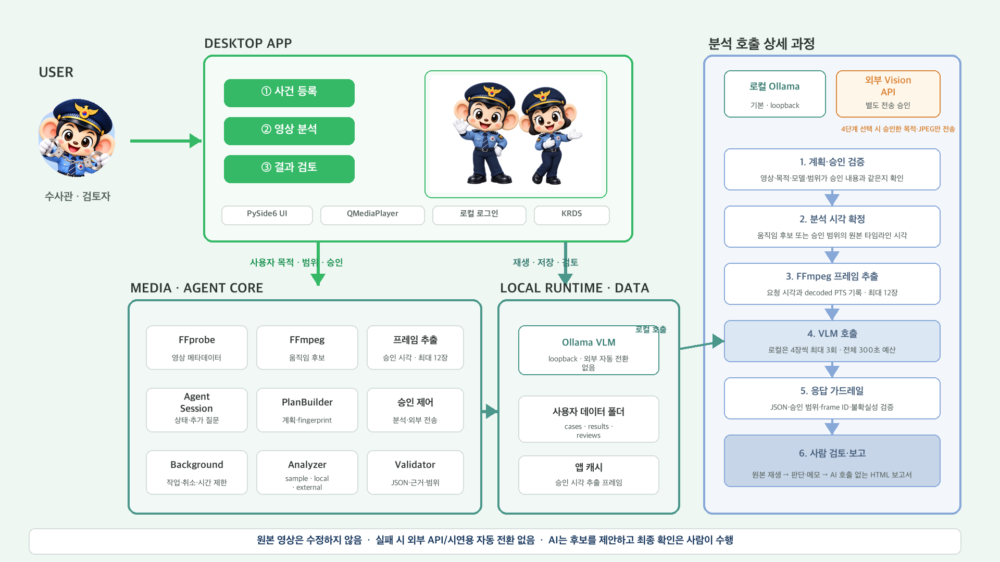

<div align="center">

<br>

<br>

# CCTV 영상수사 지원 Agent

로컬 CCTV 영상에서 **사람이 확인할 중요 구간 후보를 좁히고**,<br>
원본 재생·수사관 검토·결과 보고까지 한 흐름으로 연결하는 macOS 데스크톱 앱

**Local-first · Human-in-the-loop · Approval-based analysis**

[앱 다운로드 페이지](https://ai-agent-jeong-oh.github.io/AI_Agent/) ·
[최신 Release](https://github.com/AI-Agent-Jeong-Oh/AI_Agent/releases/latest) ·
[개발 기록](docs/progress.md)

</div>

> AI가 범죄 여부나 사람의 의도를 판단하는 시스템이 아닙니다. AI는 검토할 후보 구간을 제안하고, 최종 확인과 판단은 사람이 원본 영상에서 수행합니다.

## 목차

- [프로젝트 소개](#프로젝트-소개)
- [핵심 Workflow](#핵심-workflow)
- [기술 스택](#기술-스택)
- [시스템 구조도](#시스템-구조도)
- [주요 기능](#주요-기능)
- [안전·개인정보 설계](#안전개인정보-설계)
- [레포지토리 구조](#레포지토리-구조)
- [설치와 실행](#설치와-실행)
- [검증 현황과 한계](#검증-현황과-한계)
- [문서와 배포](#문서와-배포)

## 프로젝트 소개

### 문제

CCTV 영상은 길지만 실제로 확인해야 할 장면은 짧을 수 있습니다. 여러 영상을 처음부터 끝까지 반복 재생하면 검토 시간이 길어지고, 카메라와 후보가 늘수록 기록을 일관되게 남기기도 어려워집니다.

### 해결 방법

이 프로젝트는 영상을 대신 판정하지 않고, 사람이 검토할 범위를 줄이는 데 집중합니다.

- **로컬 영상 직접 선택**: 웹 업로드나 별도 영상 서버 없이 사용자 컴퓨터의 파일을 읽습니다.
- **제한된 후보 탐색**: 저해상도 픽셀 변화로 먼저 볼 구간을 제안하고, 승인된 원본 시각의 프레임만 분석합니다.
- **계획 확인과 승인**: 목적·모델·시간 범위·프레임 수를 실행 전에 보여줍니다.
- **엄격한 결과 검증**: 승인 범위, 실제 입력 frame ID, 관찰 근거와 불확실성을 검사합니다.
- **사람의 최종 검토**: 후보를 원본에서 다시 보고 판단·메모·태그를 기록합니다.
- **보고서 연결**: 저장된 사건·분석·검토 기록으로 편집 가능한 HTML 보고서를 만듭니다.

### 핵심 원칙

| 원칙 | 의미 |
|---|---|
| Local-first | 원본 영상은 로컬 경로에서 직접 읽고 수정하거나 저장소로 복사하지 않습니다. |
| Human-in-the-loop | 모델 결과는 후보이며 최종 확인과 관련성 판단은 사람이 수행합니다. |
| Approval-based | 분석 내용이 바뀌면 이전 승인을 폐기하고 새 계획을 다시 승인받습니다. |
| Evidence-aware | 관찰 내용, 실제 근거 시각, 불확실성을 분리해 기록합니다. |
| No silent fallback | 로컬 모델 실패를 외부 API나 시연용 결과로 자동 대체하지 않습니다. |

## 핵심 Workflow

```text
로컬 로그인
→ ① 사건 정보·CCTV 영상 등록
→ 분석 목적·사전 단서·우선 확인 상황 설정
→ 선택적으로 FFmpeg 움직임 후보 탐색
→ ② 분석 계획 생성
→ 목적·모델·범위·원본 시각·한도 확인 및 승인
→ 승인된 시각의 프레임만 제한 추출
→ 로컬 VLM 또는 별도 승인된 외부 VLM 분석
→ JSON·승인 범위·근거 frame ID·불확실성 검증
→ ③ 후보 구간 원본 재생과 사람 검토
→ 판단·메모·태그 저장
→ AI 추가 호출 없이 결과 보고서 HTML 내보내기
```

외부 AI 모드는 분석 계획 승인만으로 실행되지 않습니다. 공급자, 목적지, 목적 문구와 전송할 JPEG 원본 시각을 보여준 뒤 **외부 전송을 별도로 승인**해야 합니다.

## 기술 스택

**Desktop UI**

- Python 3.13
- PySide6 6.12 Widgets / Multimedia
- QMediaPlayer 원본 영상 재생
- KRDS 기반 UI, Pretendard GOV, 키보드 확대·축소

**Video processing**

- FFprobe: 길이·해상도·codec·회전·오디오·timebase 확인
- FFmpeg: 움직임 후보 탐색, 승인된 원본 시각의 프레임 추출
- 원본 타임라인 초와 decoded PTS 기록

**Agent & analysis**

- `AgentSession` / `PlanBuilder`: 추가 질문, 계획 fingerprint, 승인과 상태 전환
- 공통 `Analyzer` 경계: `sample`, `local`, `external`
- Ollama Vision API: `qwen3-vl:4b-instruct`, `qwen3-vl:8b-instruct` 연결 기록
- OpenAI-compatible 외부 Vision API 어댑터
- 제한된 background worker, 취소, timeout, 부분 완료 처리

**Storage & report**

- 플랫폼 사용자 데이터 폴더의 JSON 저장
- 사건·모델 결과·사람 검토 기록 분리
- 앱 소유 marker가 있는 프레임 캐시만 정리
- AI를 다시 호출하지 않는 HTML 결과 보고서

**Packaging & distribution**

- PyInstaller macOS arm64 개발 빌드
- GitHub Releases 다운로드 자산
- GitHub Actions 기반 정적 다운로드 페이지

> 앱 자체에는 웹 백엔드나 데이터베이스가 없습니다. 영상은 웹에 업로드하지 않으며, 외부 API는 사용자가 명시적으로 선택하고 전송 범위를 승인한 경우에만 사용합니다.

## 시스템 구조도



시스템은 `Desktop App → Media·Agent Core → Local Runtime·Data`로 이어집니다. 오른쪽에는 승인된 분석 계획이 프레임 추출, VLM 호출, 응답 검증, 사람 검토와 보고서로 이어지는 상세 과정을 표시했습니다.

## 주요 기능

### 1. 로컬 계정과 사건 관리

- 포돌이·포순이 시작 화면과 로컬 회원가입·로그인·로그아웃
- 여러 로컬 사용자 지원
- 비밀번호는 무작위 salt가 포함된 PBKDF2-SHA256 hash로만 저장
- 사건명·유형·발생 시각 확실성·관리 메모와 여러 CCTV 영상 연결
- 원본 영상 경로는 사건 JSON에 저장하지 않음

### 2. 분석 단서와 관찰 기준

- 단서별 문장, 출처, 확실성, 분석 사용 여부 관리
- `use_for_analysis=true`인 단서만 계획·분석 요청·결과 provenance에 포함
- 사전정보를 영상 관찰 사실과 분리해 모델 prompt에 전달
- 사건 유형별 우선 확인 상황과 사용자가 직접 입력한 짧은 힌트
- 선택하지 않은 상황도 관찰하고 범죄 여부를 판단하지 않도록 안내

### 3. 영상 메타데이터와 움직임 후보

- FFprobe 기반 영상 길이·해상도·평균/명목 FPS·회전·오디오·timebase 확인
- 일반 목적: 큰 변화가 있는 비중첩 6초 구간 제안
- 반복·방향 변화 목적: 국소 변화가 이어지는 비중첩 10초 구간 제안
- 최대 600개의 저해상도 PTS 표본만 사용
- 움직임 점수는 행동 확률이나 이상행동 판정이 아닌 상대적인 픽셀 변화량

### 4. 계획·승인 기반 Agent

- 목적이 모호할 때만 추가 질문
- 영상·목적·모델·공급자·범위·프레임 시각·단서로 계획 fingerprint 생성
- 입력이 바뀌면 기존 분석 승인과 외부 전송 승인 무효화
- 기본 실행 1회, 자동 재분석 0회, 공급자 자동 retry 0회
- 분석 범위 확대는 자동 실행하지 않고 제안만 표시

### 5. 제한된 VLM 분석

- 현재 로컬 계획은 원본 프레임 최대 12장
- 시간순 4프레임씩 최대 3회 요청, 전체 작업이 하나의 300초 예산 공유
- 반복·방향 변화는 최대 2×2 시간순 비교 보드 사용
- 손가락·버튼·접촉 목적은 전체 화면과 중앙 60% 확대 보기를 함께 제공
- 로컬 모델 endpoint는 loopback 주소만 허용
- 로컬 실패 시 외부 API나 시연용 결과로 자동 전환하지 않음

### 6. 모델 응답 가드레일

- 최상위 JSON 형식과 필수 필드 검사
- 승인 범위 밖 또는 역전된 구간 거부
- 실제 입력으로 전달하지 않은 frame ID 근거 거부
- frame ID만 복사한 관찰 근거 거부
- 지속·반복 주장은 서로 다른 근거 시각을 요구
- 범죄 성립·사람의 의도·법적 책임을 확정하는 일부 위험 표현 거부
- `completed`, 빈 결과, `partial`, `failed`, `canceled` 상태 분리
- `sample`, `test_double`, `real_model`, `none` 결과 출처 분리

### 7. 사람 중심 후보 검토

- 후보 선택 시 확인 범위의 최대 1초 전부터 원본 맥락 재생
- 미검토·관련 있음·추가 확인·제외 판단
- 메모와 태그 저장, 필터와 정렬
- 모델 결과와 사람의 검토 기록을 별도 파일로 저장
- 저장하지 않은 기록이 있으면 닫기·영상 변경·새 분석 전에 확인
- 앱이 활성 상태일 때의 사람 확인 시간을 파일에만 기록

### 8. 여러 CCTV와 인물 후보 비교

- 한 사건에 여러 CCTV 영상 등록
- 선택한 여러 로컬 영상을 영상별 계획으로 순차 분석
- 카메라별 결과 탭과 사건 전체 후보 보기
- 서로 다른 영상의 실제 로컬 모델 후보를 쌍별로 비교
- 외형 유사도 값은 신원 일치 확률이 아닌 검토 참고값
- 얼굴 검출·추적·YOLO 없이 전체 근거 프레임을 비교하므로 사람이 원본을 다시 확인해야 함

### 9. 결과 보고와 배포

- `CCTV 영상 검토 결과 보고` 6개 영역 초안
- 사건 정보·모델 후보·사람 검토 기록을 조합하고 AI는 추가 호출하지 않음
- 문구 편집과 A4 인쇄용 HTML 내보내기
- 사건 유형별 참고 조문과 영상 증거 처리 공통 규정 링크 표시
- 개발용 macOS `.app`, GitHub Release ZIP, 정적 다운로드 페이지

## 분석 방식

| 방식 | 동작 | 표시·승인 정책 |
|---|---|---|
| 시연용 | 프레임을 해석하지 않고 승인 범위 비율로 샘플 후보 생성 | `VIDEO_AGENT_ENABLE_SAMPLE=1`에서만 노출, 실제 AI 분석이 아님을 명시 |
| 로컬 AI | 이 컴퓨터의 Ollama vision 모델로 승인된 프레임 분석 | loopback만 허용, 실패 시 외부/시연용 fallback 없음 |
| 외부 AI | HTTPS 외부 Vision API에 승인된 JPEG와 목적 문구 전송 | 분석 승인과 외부 전송 승인을 분리, API key 미저장 |

## 안전·개인정보 설계

| 대상 | 정책 |
|---|---|
| 원본 영상 | 수정하지 않고 저장소에 복사·커밋하지 않습니다. |
| 영상 시간 | 프레임 번호/FPS가 아니라 원본 timeline seconds와 decoded PTS를 사용합니다. |
| 정답 라벨 | ground-truth JSON과 데이터셋 분류 경로를 analyzer나 prompt에 전달하지 않습니다. |
| 사전 단서 | 사용자 제공 정보임을 명시하고 영상 관찰 사실처럼 복사하지 않도록 합니다. |
| API key | 현재 프로세스 메모리와 인증 header에만 사용하고 설정·결과·로그에 저장하지 않습니다. |
| 외부 전송 | 목적지·목적 문구·JPEG 시각을 별도 승인하며 원본 전체·PDF·라벨 JSON은 기본 전송 대상이 아닙니다. |
| 결과 표현 | 관찰·근거·불확실성을 분리하고 범죄·의도·법적 책임을 영상만으로 추론하지 않습니다. |
| 캐시 정리 | 앱 root marker와 job marker가 모두 있는 앱 생성 디렉터리만 대상으로 합니다. |

기본 저장 위치:

```text
~/Library/Application Support/VideoAnalysisAgent/
├── local_account.json
├── settings.json
├── cases/*.json
├── results/*.json
├── reviews/<job-id>.json
└── person_comparisons/*.json

~/Library/Caches/VideoAnalysisAgent/<job-id>/
```

## 레포지토리 구조

```text
src/video_agent/
├── agent/       목적 해석, 계획 fingerprint, 승인과 상태 전환
├── analysis/    Analyzer 경계, sample/local/external 분석, batch와 worker
├── identity/    서로 다른 영상의 인물 후보 쌍별 비교
├── knowledge/   PDF 검색 계약, 공통·사건 유형별 참고 규정
├── models/      Ollama 및 OpenAI-compatible provider, runtime 조사
├── review/      사람 검토 기반 결과 요약과 문구 정책
├── storage/     로컬 계정, 설정·사건·결과·검토·캐시 경로
├── ui/          PySide6 3단계 UI, 재생, 후보 검토와 결과 보고
├── video/       FFprobe, FFmpeg, 원본 시각 프레임·움직임 처리
├── contracts.py 공통 요청·계획·결과 계약
└── __main__.py  `python -m video_agent` 진입점

tests/           계약·Agent·분석기·저장·오프스크린 UI 테스트
packaging/       PyInstaller macOS `.app` 설정
scripts/         개발환경 준비, 빌드와 Release ZIP 패키징
site/            GitHub Pages 다운로드 페이지
docs/            아키텍처·계약·개발 기록·인계 문서
.github/         다운로드 페이지 배포 workflow
```

공통 통합 경계는 [`src/video_agent/contracts.py`](src/video_agent/contracts.py)와 `python -m video_agent`입니다. 이 경계를 변경할 때는 관련 문서와 테스트를 함께 갱신하고 팀원 검토가 필요합니다.

## 설치와 실행

### 요구 환경

- macOS, Apple Silicon 개발 기준
- Python 3.13.x
- FFmpeg / ffprobe
- 로컬 AI 분석을 사용할 경우 Ollama와 vision 모델

### 1. 저장소와 Python 환경

```bash
git clone https://github.com/AI-Agent-Jeong-Oh/AI_Agent.git
cd AI_Agent
python3.13 -m venv .venv
./.venv/bin/python -m pip install --upgrade pip
./.venv/bin/python -m pip install -r requirements.txt
```

환경을 자동 변경하지 않는 준비 스크립트도 사용할 수 있습니다.

```bash
./scripts/bootstrap_macos_dev.sh --check-only
./scripts/bootstrap_macos_dev.sh --dev
```

### 2. 앱 실행

```bash
PYTHONPATH=src ./.venv/bin/python -m video_agent
```

샘플 모드는 개발·발표 시 명시적으로 활성화합니다.

```bash
VIDEO_AGENT_ENABLE_SAMPLE=1 \
  PYTHONPATH=src ./.venv/bin/python -m video_agent
```

### 3. 로컬 Ollama 분석

```bash
brew install ollama
brew services start ollama
ollama pull qwen3-vl:4b-instruct
PYTHONPATH=src ./.venv/bin/python -m video_agent
```

더 큰 비교 모델이 필요한 경우에만 `qwen3-vl:8b-instruct`를 별도로 설치하고 UI 또는 `VIDEO_AGENT_LOCAL_MODEL`로 선택합니다. 모델 가중치는 저장소나 앱 번들에 포함하지 않습니다.

### 4. 테스트

계약·분석기·UI workflow를 변경했을 때의 기준 명령:

```bash
QT_QPA_PLATFORM=offscreen PYTHONPATH=src \
  python3.13 -m unittest discover -s tests -v
```

## 검증 현황과 한계

아래는 [`docs/progress.md`](docs/progress.md)에 기록된 개발 확인 결과입니다. 현재 README를 정리하면서 실제 모델·실제 CCTV·GUI 전체 경로를 새로 실행한 결과는 아닙니다.

| 구분 | 기록된 상태 |
|---|---|
| 자동 테스트 | 2026-10-11 기준 261개 통과 기록 |
| 영상 도구 | FFmpeg 8.1.2, 한글·공백 경로 합성 H.264 영상 처리 기록 |
| 로컬 VLM | `qwen3-vl:4b-instruct`, `qwen3-vl:8b-instruct` 실제 이미지 입력 연결 기록 |
| 제공 영상 | 알려진 단일 영상의 후보 생성 확인이며 blind 정확도 평가가 아님 |
| 외부 API | 가짜 provider로 요청 구성·key 미저장 확인, 실제 과금 호출은 미수행 |
| macOS 앱 | arm64 개발용 `.app` 빌드 기록, ad-hoc 서명 상태 |

아직 별도 검증이 필요한 항목:

- 새로운 실제 CCTV를 사용한 blind 행동 탐지 정확도 평가
- 실제 외부 Vision API의 비용·개인정보·보관 정책과 payload 확인
- PDF 자료 추출·색인·검색 및 사건별 법령 연결
- 국가법령정보센터 원문과 참고 규정의 최신 대조
- 지원 대상 macOS의 개발자 인증서 서명·공증·배포 호환성
- Finder에서 연 앱의 전체 기능·접근성·오디오·장시간 안정성 수동 확인

모델 연결 성공이나 특정 개발 영상의 후보 생성은 일반적인 행동 탐지 정확도를 의미하지 않습니다.

## 문서와 배포

- [아키텍처](docs/architecture.md)
- [UI·Agent·분석·PDF 검색 계약](docs/contracts.md)
- [현재까지 구현 기록과 검증 범위](docs/progress.md)
- [역할별 다음 작업](docs/tasks.md)
- [개발 인계](docs/handoff-seungjae.md)
- [다운로드 페이지·Release 연결](docs/download-page.md)

### 개발용 `.app`

```bash
./.venv/bin/python -m pip install -r requirements-dev.txt
./scripts/build_macos_app.sh
open dist/VideoAnalysisAgent.app
```

결과는 `dist/VideoAnalysisAgent.app`입니다. 현재 배포물은 Apple Silicon용 개발 빌드이며 개발자 인증서 서명·공증과 다른 Mac에서의 실행은 별도 검증이 필요합니다. 받는 Mac에도 FFmpeg/ffprobe, Ollama와 사용할 vision 모델이 별도로 설치되어 있어야 합니다.

Release ZIP과 다운로드 페이지 구성은 [`docs/download-page.md`](docs/download-page.md)를 따릅니다. 영상, 데이터셋 archive, label, 모델 weight, credential, `.env`, 개인 결과와 cache는 저장소에 커밋하지 않습니다.
